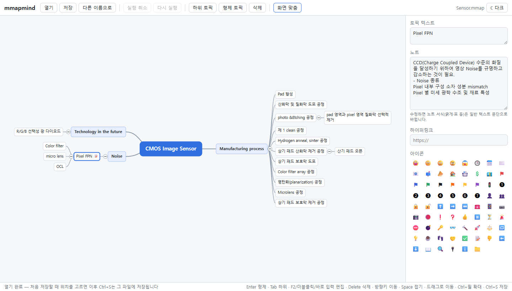
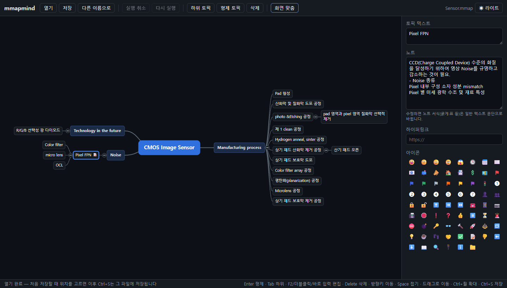

# mmapmind

MindManager `.mmap` 파일을 브라우저에서 열고 편집해 다시 `.mmap`으로 저장하는 웹 마인드맵 편집기입니다.
서버 없이 브라우저 안에서만 동작하며, 편집하지 않은 부분(서식·관계선·첨부 등 모델이 다루지 않는 요소와 ZIP의 다른 엔트리)은 원본 그대로 보존합니다.



<details>
<summary>다크 테마</summary>



</details>

## 사용 방법

1. **열기** 버튼을 누르거나 `.mmap` 파일을 창에 끌어다 놓습니다.
2. 토픽을 클릭해 선택하고, 바로 입력하거나 F2·더블클릭으로 텍스트를 고칩니다. Enter는 형제, Tab은 하위 토픽을 추가합니다.
3. 토픽을 다른 토픽 위로 드래그하면 그 아래로 옮겨집니다. 빈 곳을 드래그하면 화면이 이동하고, Ctrl+휠로 확대/축소합니다.
4. 오른쪽 속성 패널에서 노트·하이퍼링크·아이콘을 편집합니다.
5. **저장**(Ctrl+S)으로 저장합니다. Chrome/Edge에서는 원본 파일에 바로 덮어쓰고, 다른 브라우저에서는 다운로드됩니다. 저장하지 않은 변경이 있으면 툴바 파일명 앞에 ●가 표시됩니다.
6. 툴바 오른쪽 끝 **다크/라이트** 버튼으로 테마를 바꿉니다.

## 기능

- `.mmap` 열기: 파일 선택 또는 창에 끌어다 놓기
- 저장: Chrome/Edge에서는 File System Access API로 원본 파일에 바로 저장(Ctrl+S), 그 밖의 브라우저는 다운로드
- 토픽 편집: 추가(하위/형제)·삭제·텍스트 수정·드래그로 이동·접기/펼치기, undo/redo(최대 200단계)
- 속성 패널: 토픽 텍스트, 노트(일반 텍스트로 편집), 하이퍼링크, 스톡 아이콘
- 화면: 좌우 균형 트리 레이아웃, 확대/축소·이동, 화면 맞춤
- **라이트/다크 테마**: 툴바 오른쪽 끝 버튼으로 전환. 선택은 브라우저(localStorage)에 기억되며, 한 번도 고르지 않았으면 OS 설정을 따릅니다

### 단축키

| 키 | 동작 |
| --- | --- |
| Enter | 형제 토픽 추가 |
| Tab / Insert | 하위 토픽 추가 |
| F2 / 더블클릭 / 바로 입력 | 텍스트 편집 |
| Delete | 삭제 |
| 방향키 | 선택 이동 |
| Space | 접기/펼치기 |
| Ctrl+Z / Ctrl+Y | 실행 취소 / 다시 실행 |
| Ctrl+휠 | 확대/축소 |
| Ctrl+S | 저장 |

### 제한 사항

- 토픽 이미지는 표시만 하고 편집할 수 없습니다.
- 노트를 수정하면 굵게·표 등 서식이 사라지고 일반 텍스트 문단으로 바뀝니다.
- 아이콘은 원본 이미지가 없어 이모지·색 깃발로 근사 표시합니다.

## 개발

Node.js 24 기준으로 개발했습니다.

```sh
npm install
npm run dev       # 개발 서버
npm run build     # 타입 검사 + 프로덕션 빌드 (dist/)
npm run preview   # 빌드 결과 미리보기
npm test          # vitest
npm run lint      # oxlint
```

### 보조 스크립트

```sh
npm run inspect -- samples/Sensor.mmap   # ZIP 엔트리, 요소/속성, ap:Topic 자식 순서 출력
npm run make-edited                      # samples/*.mmap을 편집해 test-output/*.edited.mmap 생성 (MindManager 호환성 수동 확인용)
node scripts/_v.mjs <파일.mmap>          # 파일 하나의 Document.xml을 번들 XSD로 검증
```

## 구조

```
src/
  format/   .mmap 읽기/쓰기 (ZIP + Document.xml), 순수 데이터 모델, XSD 순서표
  store/    zustand 편집기 상태 (immer, undo/redo)
  layout/   트리 레이아웃과 텍스트 측정
  view/     SVG 마인드맵 캔버스, 아이콘 표시
  ui/       속성 패널(Inspector), 테마
  io/       파일 열기/저장
tests/      왕복·편집 테스트 (samples/*.mmap 사용, XSD 검증 포함)
samples/    테스트용 실제 MindManager 파일
scripts/    분석·검증 스크립트
docs/       README용 스크린샷
```

테스트는 `samples/`의 모든 `.mmap`에 대해 무편집 저장 시 바이트 동일성, 편집 후 XSD 유효성, 재읽기 일치를 확인합니다.
